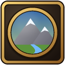
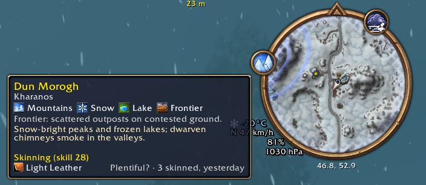
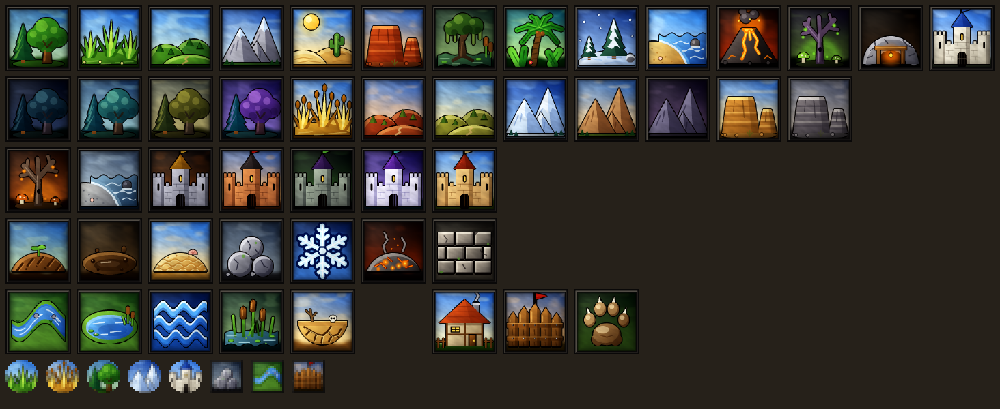
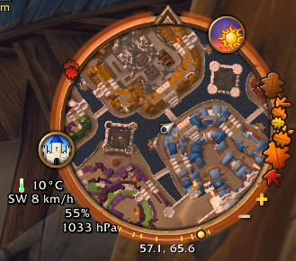

# ImmerseMe: Geography

The lie of the land on your minimap, for roleplayers in **World of Warcraft: Forever**.

A small orb on the upper-left of the minimap shows the land you're standing in: forest, hills,
desert, swamp, snowy peaks, a city. Hover it for the ground underfoot, the water nearby and how wild
the country is. If your character gathers, it also shows the ores, herbs, game and fish you have
found there.

## What it does

- **The land at a glance**: one terrain picture, coloured like the zone. Westfall is golden
  grassland, Redridge red hills, Duskwood a dark forest.
- **Learned, not looked up.** A zone's resources stay hidden until *you* gather them there. Mine
  copper in Westfall, and Westfall's copper appears.
- **Skill makes you sure.** A novice's guess may be a little off; with practice it becomes exact.
- **Your own record**: how much you've gathered in a zone, and when.
- **Every classic zone**, plus the dungeons and mines where gathering happens.

## Install

1. Download `ImmerseMe_Geography-vX.Y.Z.zip` from the [latest release](../../releases/latest).
2. Extract it into `World of Warcraft/_forever_/Interface/AddOns/`. You should end up with an
   `AddOns/ImmerseMe_Geography` folder.
3. Restart the game (a `/reload` is not enough the first time).

## Commands

| Command | What it does |
|---|---|
| `/img` | Describe the land here in chat |
| `/img known` | Everything you've learned about this zone |
| `/img show` / `/img hide` | Show or hide the orb |
| `/img style row` | Four small icons under the zone name instead of the orb (`/img style orb` goes back) |
| `/img help` | Every other command |

`/geography` works too.

## Good to know

- **English only** for now: all of the addon's text is in English, and it is only tested with an
  English game client.
- Works on its own. It pairs well with
  [ImmerseMe: Weather](https://github.com/holyc4t/ImmerseMe_Weather) (the sky) and
  [ImmerseMe: Seasons](https://github.com/holyc4t/ImmerseMe_Seasons) (the year), but needs neither.

## More

- [How it works](docs/how-it-works.md) and [customizing it](docs/customizing.md)
- [Contributing](CONTRIBUTING.md)

## License

[MIT](LICENSE). World of Warcraft is a trademark of Blizzard Entertainment. This is a fan project,
not affiliated with or endorsed by Blizzard.
