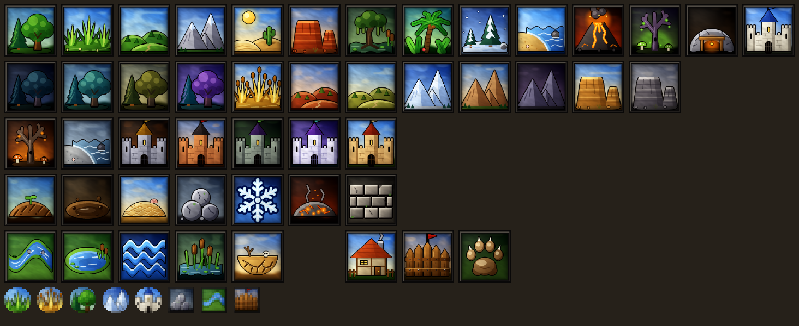

<!--
Text for the CurseForge project page. CurseForge accepts Markdown:
paste everything below the line into the project description.
Upload docs/images/icons.png (and a minimap screenshot) as project images
and replace the image links with the CurseForge-hosted URLs.

Summary field (max 125 characters):
The lie of the land on your minimap: terrain, ground, water and wildness, and the riches your gatherer has found.
-->
---

# ImmerseMe: Geography

**Know the land you stand on.** A gold-ringed land orb on the minimap shows the terrain; hover it for the ground underfoot,
the water and how wild the country is. Gatherers learn what each zone holds by working it.

## What you get

- **The land at a glance**: forest, hills, mountains, desert, swamp, jungle, tundra, coast, volcanic,
  blighted, underground and more, with ground, water and wildness alongside.
- **Riches you've earned**: ores, herbs, leather and fish appear only after you gather them in that
  zone, and only for professions you have. Nothing extra on screen: hover the icons for *Scarce*, *Common* or *Plentiful*.
- **Skill matters**: a novice's reading may be off and shows greyed; a veteran knows for sure.
- **Your own record**: the tooltip shows how many you've gathered there and when.
- **A veteran's hunch** when a zone still hides riches you haven't found.
- Mirrors **ImmerseMe: Weather**'s sky orb across the minimap, clear of your buffs.

## Commands

Type `/img help` in game. The most used:

- `/img` describes the land here
- `/img known` lists what you've learned about this zone
- `/img style orb | row` switches between the orb and a row of all four land icons

Part of the **ImmerseMe** roleplay suite. MIT licensed, source on GitHub.
